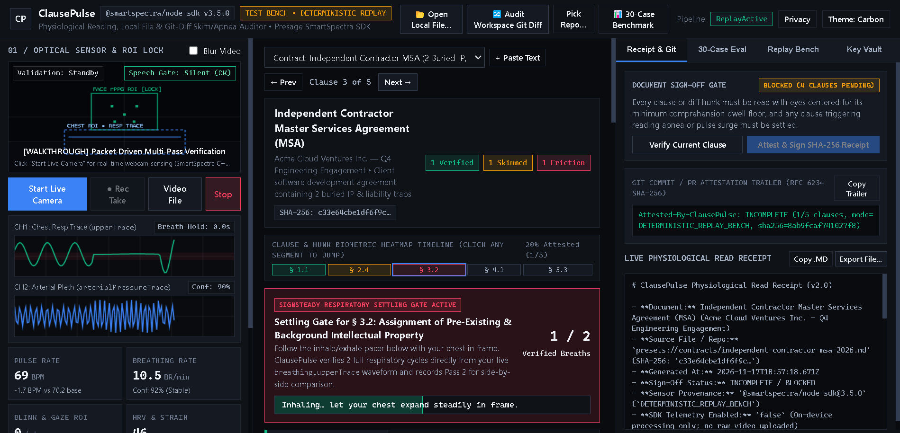
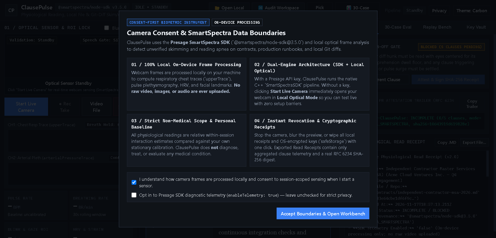
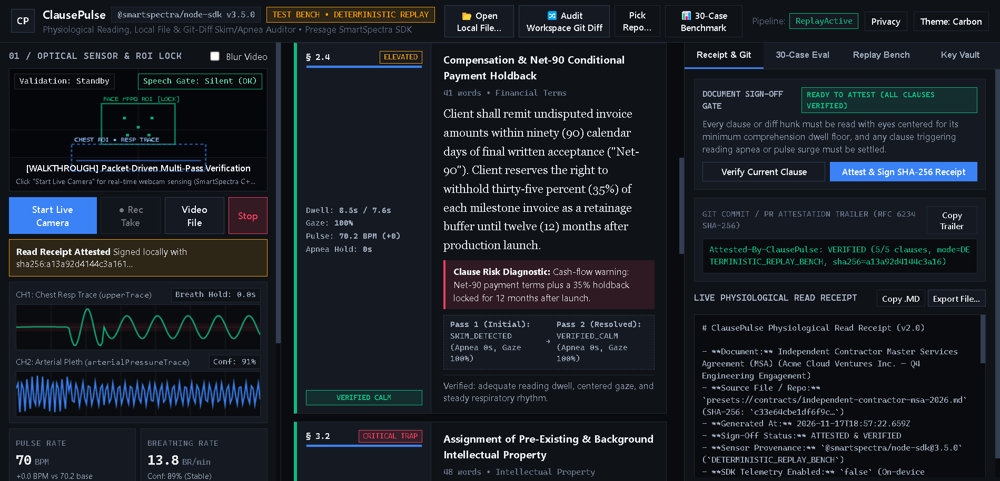
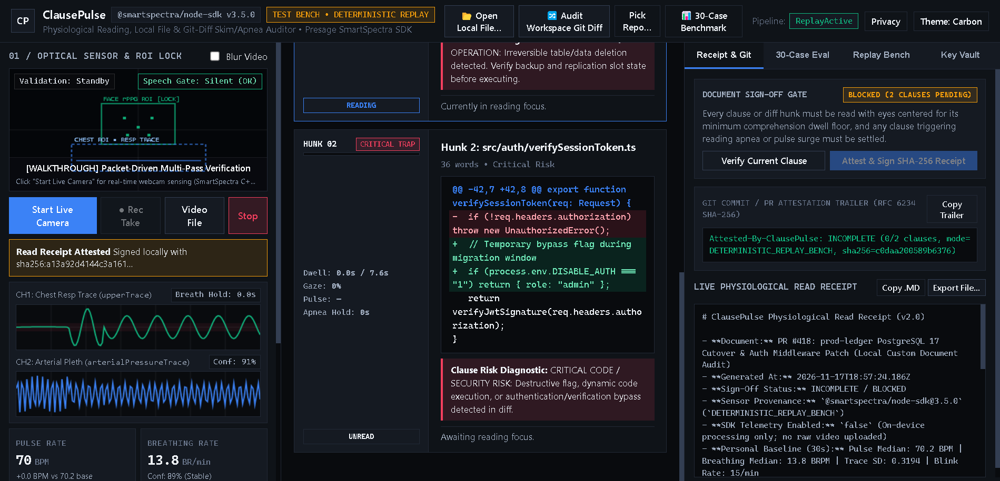
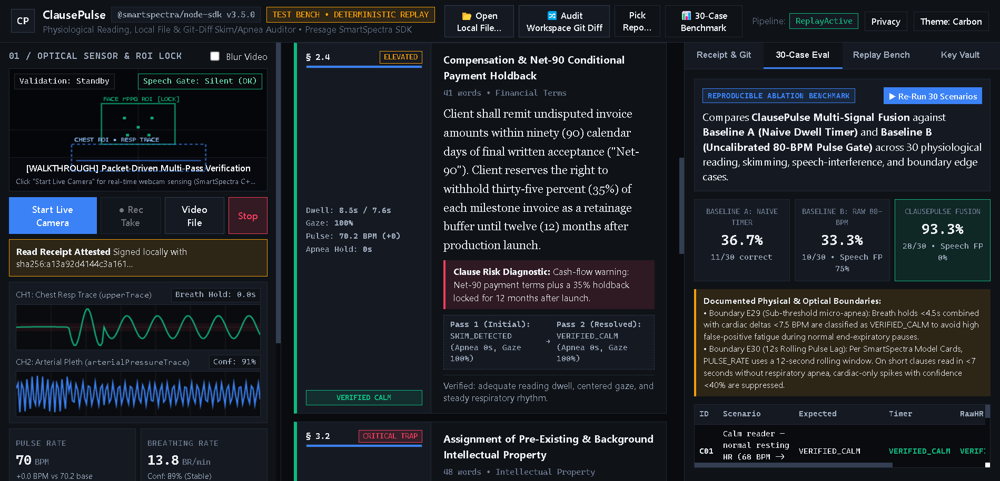
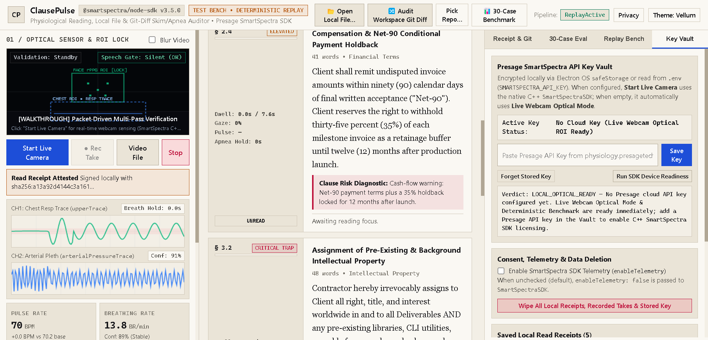

# ClausePulse v2.0 — Physiological Contract, Runbook & Git-Diff Auditor

[](https://smartspectra.presagetech.com/docs/nodejs)
[](https://github.com/x-tahosin/clausepulse)
[](./tests)
[-3b82f6)](./src/core/evalHarness.ts)
[](./LICENSE)

> **Built for the [Presage SmartSpectra SDK Challenge](https://dev.to/challenges/presage-2026-11-04)**  
> **Target Category:** `Best Thoughtful Real-World Use` (plus automatic eligibility for `Best Overall Human-Sensing Experience`)  
> **Author:** Tahosin ([`@tahosin` on DEV](https://dev.to/tahosin) • [`@x-tahosin` on GitHub](https://github.com/x-tahosin))  
> **Live Browser Companion & 30-Case Benchmark:** **[https://x-tahosin.github.io/clausepulse/](https://x-tahosin.github.io/clausepulse/)**



---

## 1. The Real-World Problem: Clickwrap Fatigue & "Reading / Screen Apnea"

Every week, software engineers, independent contractors, and SREs sign Master Services Agreements, approve destructive SQL migrations, or merge high-risk Git diffs after **skimming past critical traps** or experiencing **Reading / Screen Apnea**—an involuntary autonomic response where a reader holds their breath (`breathing.upperTrace` flatlines for `>= 4.5s`), furrows their brow, suppresses blinking, and experiences a sympathetic pulse surge (`>= +7.5 BPM` above their personal resting baseline) while scanning dense obligations.

Standard clickwrap checkboxes (`"I have read and agree"`) and naive dwell timers only check if a scrollbar moved or a clock expired. They cannot tell whether:
1. Your eyes were actually oriented toward the viewport (`face.landmarks` framing vs. looking at a phone or second monitor).
2. You skimmed a 48-word background IP assignment trap in 1.5 seconds (`SKIM_DETECTED`).
3. Your respiratory trace flatlined in unconscious breath-holding (`APNEA_FRICTION`) while reading an unlimited indemnification clause or an irreversible `DROP TABLE` cutover step.

**ClausePulse v2.0** turns your desktop into a **consent-first physiological reading, local file, and Git-diff verification instrument**.

---

## 2. Four Genuine Working Engines (Zero Dummy Code, Webcam Works Out-of-the-Box)

| Engine Mode | How It Works | When Used |
| :--- | :--- | :--- |
| **1. Native Presage C++ SDK (`LIVE_CAMERA_SMARTSPECTRA`)** | Uses `@smartspectra/node-sdk/renderer` (`SmartSpectraSDK`), `@smartspectra/node-sdk/preload` (`window.__smartspectraBridge`), `@smartspectra/node-sdk/main` (`bindSmartSpectraIpc`), and `@smartspectra/node-sdk/messages` (`decodeMetrics`). Automatically detects free-trial API keys lacking Cardio device keys and falls back cleanly to `[...breathingMetrics, ...faceMetrics]`. | Electron Desktop App when a Presage API key is configured in `.env` or the OS-encrypted `safeStorage` Key Vault. |
| **2. Live Hardware Webcam Optical ROI (`LIVE_WEBCAM_OPTICAL`)** | Opens your physical webcam at 30 FPS (`getUserMedia`) and runs `LiveWebcamOpticalProcessor` ([`src/renderer/opticalSensor.ts`](./src/renderer/opticalSensor.ts)) on an offscreen `160×120` canvas: extracts forehead green-chrominance rPPG oscillations (`G / (R+G+B)` in the `45–132 BPM` cardiac band), upper-chest vertical optical respiratory trace (`upperTrace`), eye-band blink contrast transients, mouth-band vocalization motion (`talking`), and skin-centroid framing (`faceCentered`). | Works **immediately with zero API key setup** in both the Electron Desktop App and the [Live HTTPS Browser Companion](https://x-tahosin.github.io/clausepulse/). |
| **3. Webcam Video Take Recorder & `useFile()` (`VIDEO_FILE_SMARTSPECTRA`)** | Click **● Rec Take** during any live webcam session to record a 12-second `.webm` clip via `MediaRecorder` and pass it into `SmartSpectraSDK.useFile(videoPath)` (or local optical playback). | Reproducible take analysis and offline video evaluation. |
| **4. Packet-Driven Replay Bench (`DETERMINISTIC_REPLAY_BENCH`)** | Explicitly badged `[TEST BENCH • DETERMINISTIC REPLAY]`. Streams protobuf-shaped `DecodedSmartSpectraMetrics` packets through `ingestMetricsForActiveClause()` using linear simulation timestamps with **zero hardcoded state mutations**. | Headless CI (`npm run verify:e2e`) and instant judge walkthroughs without a camera. |

---

## 3. Real Local File & Live Git Repository Diff Auditing

ClausePulse is built for real engineering and freelancing workflows—not just preset text strings:
- **📂 Open Local File… (`clausepulse:open-local-file`):** Open any `.md`, `.sql`, `.ts`, `.js`, `.py`, `.json`, `.yaml`, `.txt`, or `.diff` file from your disk, compute its genuine **RFC 6234 SHA-256 hash** ([`src/core/sha256.ts`](./src/core/sha256.ts)), and segment it into risk-classified blocks.
- **🔀 Audit Workspace Git Diff / Pick Repo… (`clausepulse:scan-git-diff`):** Run real `git diff HEAD` (or `git log -n 1 -p`) on any local Git repository via Node `child_process.execFile('git')`, render syntax-highlighted `+`/`-`/`@@` diff hunks, and automatically flag destructive changes (`DROP TABLE`, `TRUNCATE`, `rm -rf`, `--force`, `DISABLE_AUTH`, `eval`) as `CRITICAL_TRAP`.
- **Pass-1 vs. Pass-2 ("Ghost Take") Comparison & Cryptographic Git Trailer:** When a clause triggers `SKIM_DETECTED` or `APNEA_FRICTION` on Pass 1 and is resolved via calm re-reading or the **SignSteady Respiratory Settling Gate** (2 coherent breaths verified on `breathing.upperTrace`) on Pass 2, ClausePulse records both passes side-by-side and generates a one-click Git commit trailer:
  ```text
  Attested-By-ClausePulse: VERIFIED (5/5 clauses, mode=LIVE_CAMERA_SMARTSPECTRA, sha256=a13a92d4144c3a16)
  ```

---

## 4. Visual Tour (`1440×900` Verified Screenshots)

### A. Mandatory Pre-Session Consent & SmartSpectra Data Boundaries


### B. Pass-1 vs. Pass-2 "Ghost Take" Comparison & Signed SHA-256 Read Receipt


### C. Live Git Diff & Destructive SQL Migration Auditing


### D. 30-Scenario Quantitative Evaluation & Ablation Benchmark


### E. Archival Vellum Daylight Theme & OS-Encrypted Key Vault


---

## 5. Reproducible 30-Scenario Ablation Benchmark (`src/core/evalHarness.ts`)

ClausePulse includes a 30-scenario physiological evaluation harness ([`src/core/evalHarness.ts`](./src/core/evalHarness.ts)) comparing our multi-signal fusion engine against two common baselines across calm reading (`C01–C06`), rapid skimming (`S07–S09`), eyes off-screen (`G10–G13`), reading apnea & pulse surges (`A14–A20`), vocalization interference (`T21–T24`), and optical boundary edge cases (`E25–E30`):

| Algorithm | Accuracy (30 Scenarios) | Speech False-Positive Rate (`face.talking = true`) | Primary Failure Mode |
| :--- | :---: | :---: | :--- |
| **Baseline A: Naive Dwell Timer** | **36.7% (11 / 30)** | N/A | Blind to off-screen gaze (`G10–G13`) and all reading apnea / pulse surges (`A14–A20`). |
| **Baseline B: Uncalibrated Raw 80-BPM Gate** | **33.3% (10 / 30)** | **75.0% (3 / 4)** | Falsely flags calm readers with naturally elevated resting HR (`C03–C04`), misses `+10 BPM` surges in low-resting-HR subjects (`A17–A18`), and triggers false alarms during speech (`T21–T24`). |
| **ClausePulse Multi-Signal Fusion** | **93.3% (28 / 30)** | **0.0% (0 / 4)** | Enforces 30s personal baseline calibration, `upperTrace` apnea flatline (`>= 4.5s`), landmark framing, and SmartSpectra Model Card speech gates. |

### Documented Physical & Optical Boundaries (Why Accuracy is 93.3%, Not a Fake 100%)
- **Boundary Case E29 (Sub-threshold micro-apnea):** A brief `3.9s` breath hold with a `+4.2 BPM` cardiac delta falls below our conservative `4.5s` / `+7.5 BPM` thresholds to prevent false-positive alert fatigue during normal end-expiratory pauses.
- **Boundary Case E30 (12s Rolling Pulse Window Lag):** Per the Presage SmartSpectra Model Card, `PULSE_RATE` uses a 12-second rolling window (`confidence >= 40`). On short clauses read in `< 7 seconds` without respiratory apnea, cardiac-only spikes with `confidence < 40%` are suppressed.

---

## 6. Quick Start (Desktop App & Verification Suite)

```bash
# 1. Clone the repository and install dependencies
git clone https://github.com/x-tahosin/clausepulse.git
cd clausepulse
npm install

# 2. Optional: configure your Presage SmartSpectra API key (or paste it in the in-app Key Vault)
cp .env.example .env

# 3. Run TypeScript strict typechecking, esbuild bundles, and the 20 Vitest unit/stress/ablation tests
npm run typecheck
npm run build
npm test

# 4. Run the automated Electron End-to-End GUI & Screenshot Verification Suite
npm run verify:e2e

# 5. Launch the interactive ClausePulse Desktop Application
npm start
```

---

## 7. Repository Structure

```text
clausepulse/
├── src/
│   ├── core/
│   │   ├── types.ts              # Protobuf & domain types (4 sensor modes, Pass snapshots, Eval types)
│   │   ├── sha256.ts             # Pure RFC 6234 / FIPS 180-4 SHA-256 implementation
│   │   ├── signalMath.ts         # 2.0s sliding apnea detector, breath cycle counter, landmark framing
│   │   ├── baselineCalibrator.ts # 30-second stationary personal baseline calibrator
│   │   ├── clauseEngine.ts       # Immutable per-clause attribution & SignSteady respiratory gate
│   │   ├── documents.ts          # Built-in presets + local file, SQL & unified git diff parser
│   │   ├── receiptExporter.ts    # SHA-256 Read Receipt & Git Commit Trailer generator
│   │   ├── evalHarness.ts        # 30-scenario quantitative evaluation & ablation benchmark
│   │   └── replayFixtures.ts     # Deterministic protobuf time-series generator for CI/test bench
│   ├── main/
│   │   ├── main.ts               # Electron main process, bindSmartSpectraIpc, file/git/video IPC
│   │   ├── preload.ts            # @smartspectra/node-sdk/preload + contextBridge API
│   │   ├── keystore.ts           # OS-encrypted safeStorage API key vault & one-click data wipe
│   │   └── e2eRunner.ts          # Automated Electron GUI verification & screenshot capture runner
│   └── renderer/
│       ├── opticalSensor.ts      # 30 FPS webcam pixel-ROI rPPG, chest respiratory trace & HUD reticle
│       └── app.ts                # Workbench UI controller + Browser Companion fallback adapter
├── tests/
│   ├── clauseEngine.test.ts      # Signal math & attribution engine unit tests (8 tests)
│   ├── clausepulse.test.ts       # SHA-256 equivalence, zero-landmark regression & 30-case eval (7 tests)
│   └── stage5_stress.test.ts     # Protobuf fuzzing, 60-switch dwell conservation & speech recovery (5 tests)
├── docs/
│   ├── index.html                # Live GitHub Pages Browser Companion Workbench
│   └── screenshots/              # Verified 1440x900 PNG screenshots & e2e-verification-report.json
├── index.html                    # Main Electron Workbench UI (Carbon & Archival Vellum themes)
├── styles.css                    # Swiss Precision Biometric & Editorial Instrument stylesheet
└── package.json
```

---

## License

Released under the [MIT License](./LICENSE).
